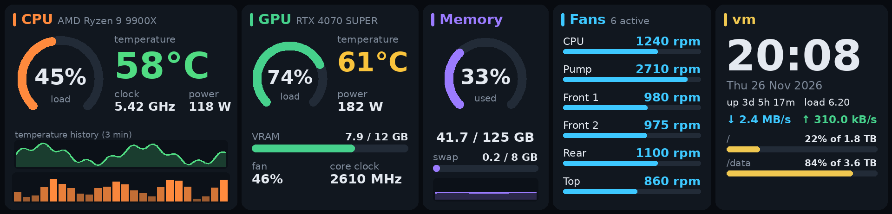

# jlscreen: Jungle Leopard screen monitor for Linux



**Status: tested and working** on a Jungle Leopard 9.16" (1920 × 462) screen under Ubuntu, with an AMD Ryzen 9 9900X (November 2026). It ran correctly straight after `sudo ./install.sh`, with no changes to the default settings.

Drives the Jungle Leopard 9.16" (1920 × 462) USB mini screen from Linux. It reads CPU, GPU, memory, fan, disk and network data and shows it as a live dashboard, refreshed every second, in place of the Windows app.

Panels, left to right:

- **CPU**: load gauge, temperature (coloured green / amber / red), clock, package power, 3-minute temperature history, per-thread load bars
- **GPU**: load, temperature, power, VRAM, fan and core clock (NVIDIA via `nvidia-smi`, AMD via `amdgpu`)
- **Memory**: RAM gauge, used / total, swap, history
- **Fans**: every fan header that is spinning, with RPM and bar
- **System**: clock, date, uptime, load average, network down / up, disk usage

## Install

```bash
git clone https://github.com/richardaj-lgtm/Jungle-Leopard-PC-information-screen-Linux.git
cd Jungle-Leopard-PC-information-screen-Linux
sudo ./install.sh
```

Tested on Ubuntu; it should work on any Debian-based distribution. On other distributions, install Python 3 with psutil, Pillow and pyserial plus lm-sensors, then follow the steps in `install.sh` by hand.

The installer adds the packages it needs (`python3-psutil`, `python3-pil`, `python3-serial`, `lm-sensors`). It then copies the program to `/opt/jlscreen`, puts the settings in `/etc/jlscreen.conf`, adds a udev rule for the screen and starts the `jlscreen` service, which runs at every boot from then on.

## First checks

```bash
jlscreen list        # the screen shows as 33c3:xxxx  <-- Jungle Leopard
jlscreen sensors     # lists every temperature and fan this PC exposes
```

**Orientation.** The panel inside the 9.16" screen is mounted on its side, so frames are turned 90° by default (`rotate = 90`). If the picture comes out upside down or sideways, stop the service and try the test pattern:

```bash
sudo systemctl stop jlscreen
jlscreen test --rotate 90     # then 270, 0, 180 until the colour strip is at the top
```

Put the value that works in `/etc/jlscreen.conf`, then run `sudo systemctl start jlscreen`.

## Settings (`/etc/jlscreen.conf`)

After any change, run `sudo systemctl restart jlscreen`.

| Setting | What it does |
|---|---|
| `rotate` | 0 / 90 / 180 / 270, see above |
| `brightness` | backlight 0–100 |
| `interval` | seconds between updates (1.0 default) |
| `cpu_temp` | `auto`, or e.g. `k10temp:Tctl` (AMD) / `coretemp:Package id 0` (Intel) |
| `fans` | `auto` (every spinning fan), or named list: `nct6799:fan1=CPU, nct6799:fan2=Pump, nct6799:fan4=Front` |
| `gpu` | `auto`, `nvidia`, `amd` or `none` |
| `disks` | mount points, e.g. `/, /home, /data` |
| `title` | heading of the system panel (default: the PC's hostname) |
| `protocol` | `auto`; force `raw` or `envelope` only if the screen stays blank |

Use the exact names `jlscreen sensors` prints for `cpu_temp` and `fans`.

## If something is missing

**No fans shown.** Fan speeds come from the motherboard's Super I/O chip. The installer runs `sensors-detect --auto`. If fans still don't show after a reboot, run `sudo sensors-detect` and answer yes. On most AM5 boards the chip is a Nuvoton NCT67xx (`nct6775` driver, built into Ubuntu's kernel). Most recent MSI boards use an NCT6687, which needs the out-of-tree `nct6687d` driver from GitHub (Fred78290/nct6687d).

**No CPU power.** Package power comes from RAPL, which only root can read. The service runs as root, so it shows there; it is blank when you run `jlscreen preview` as a normal user.

**No GPU.** NVIDIA needs the proprietary driver (`nvidia-smi` must work). AMD cards are read directly from `amdgpu`. If you have both a discrete card and the Ryzen iGPU, the card with the most VRAM is used.

**Screen stays blank.** Check the log with `journalctl -u jlscreen -f`. Run `jlscreen -v info` to see the firmware version and raw traffic. Firmware older than 2.8 takes plain JPEG frames and newer firmware wraps them. `auto` picks the right one from the version the screen reports, and `protocol = raw` / `envelope` forces it.

## Other commands

```bash
jlscreen preview -o dash.png          # render the dashboard to a picture, no screen needed
jlscreen brightness 40
jlscreen run                          # run in the foreground (stop the service first)
sudo ./uninstall.sh
```

## Notes

The screen's protocol isn't published. This tool follows two independent reverse-engineering efforts on the vendor's app: [nickadam/jungle-leopard](https://github.com/nickadam/jungle-leopard), tested on the 9.16" D215 with firmware 2.2, and the JlPanel driver in [Selflocking/InfoPanel-linux](https://github.com/Selflocking/InfoPanel-linux) (firmware 2.8+). The screen is a USB serial device (vendor ID 33c3) at 2 Mbaud. It takes JPEG frames of up to 80 kB and needs a keep-alive at least every 1.5 s, or it falls back to its built-in screen.

## Contributing

Issues and pull requests are welcome, particularly reports from other Jungle Leopard / Hongtai screen models and sizes. Please include the output of `jlscreen -v info` with any report.

## Licence

MIT; see [LICENSE](LICENSE).
